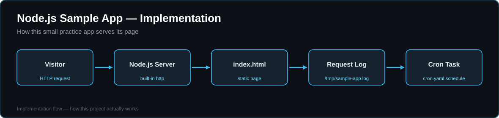

# Node.js Sample Web App




A lightweight Node.js web application that serves a static page using Node's built-in `http` module — no frameworks, no dependencies.

Originally set up as an AWS Elastic Beanstalk sample-style deployment, including a `cron.yaml` scheduled-task example.

## What's inside

- `app.js` — HTTP server (port 3000 by default, or `PORT` env var) that serves `index.html` and logs requests with timestamps to `/tmp/sample-app.log`
- `index.html` — the static page served by the app
- `cron.yaml` — example scheduled task configuration (Elastic Beanstalk worker cron format), hitting `/scheduled` every minute
- `package.json` — start script: `node app.js`

## Run it locally

```bash
node app.js
# then open http://localhost:3000
```

## Notes

This is a small practice project from my early DevOps learning — kept here as part of the journey. My production-style projects are on my profile: ECS/EKS CI/CD pipelines and Terraform infrastructure.
